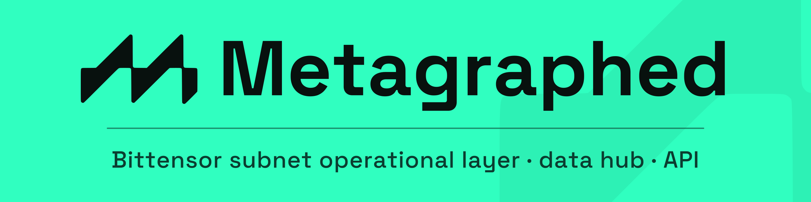

<div align="center">

<a href="https://metagraph.sh"></a>

### Every subnet, metagraphed.

**The open registry and block explorer for Bittensor.** All 128 subnets, the APIs and schemas each one publishes, whether those endpoints answered our last probe, and how to call them — as REST, MCP tools and CSV.

Bittensor didn't ship with a map, so we drew one. Every health figure here is probe-derived on a 15-minute cycle; none of it is self-reported.

[](https://metagraph.sh)
[](https://api.metagraph.sh/mcp)
[](https://registry.modelcontextprotocol.io/v0/servers?search=metagraphed)
[](https://mcp.so/server/metagraphed---bittensor-subnet-registry/JSONbored)
[](https://smithery.ai/servers/metagraphed/metagraphed)
[](https://www.npmjs.com/package/@jsonbored/metagraphed)
[](https://pypi.org/project/metagraphed/)
[](./LICENSE)

**[Website](https://metagraph.sh)** &nbsp;·&nbsp; [API](https://api.metagraph.sh) &nbsp;·&nbsp; [OpenAPI](https://api.metagraph.sh/metagraph/openapi.json) &nbsp;·&nbsp; [MCP](https://api.metagraph.sh/mcp) &nbsp;·&nbsp; [Agent docs](https://api.metagraph.sh/llms.txt) &nbsp;·&nbsp; [Agent workflows](https://api.metagraph.sh/agent-workflows.md) &nbsp;·&nbsp; [Feeds](https://api.metagraph.sh/api/v1/feeds/registry) &nbsp;·&nbsp; [npm](https://www.npmjs.com/package/@jsonbored/metagraphed) &nbsp;·&nbsp; [PyPI](https://pypi.org/project/metagraphed/)

</div>

---

## What it is

The native Bittensor metagraph tells you what's happening at the protocol layer. Metagraphed adds the **builder-facing layer it lacks**: a chain-direct block explorer (its own Rust indexer, no third-party RPC dependency), a registry of every subnet's public interfaces, endpoint health, and machine-readable schemas, and an agent toolkit — 200+ MCP tools, paste-ready OpenAI/Anthropic specs, a drop-in skill — built for **integration developers**, often reached through their AI agents. A live read-only RPC/WSS proxy and non-custodial, wallet-signed staking/delegation round it out.

> **Not** an official OpenTensor/Bittensor project · **not** a replacement for the native metagraph · **not** an alpha/price dashboard · **not** custodial — staking and delegation are wallet-signed client-side; keys and credentials never touch our backend.

The web UI lives at **[metagraph.sh](https://metagraph.sh)**. The API is served from **`https://api.metagraph.sh`** (REST under `/api/v1`, artifacts under `/metagraph`).

## Quickstart

Three ways to use Metagraphed. Pick one.

#### 🤖 AI agent (MCP)

Agent-native, account-authenticated, Streamable-HTTP. Sign-in is free. 200+ tools to explore the chain, discover a subnet, check if it's up, read its economics and metagraph, trace what a wallet does across the network, and learn how to call it.

```bash
claude mcp add --transport http metagraphed https://api.metagraph.sh/mcp
```

<details>
<summary><b>Other clients</b> — Cursor, VS Code, Windsurf, Zed, ChatGPT, or anything speaking MCP</summary>

Add an MCP server with url `https://api.metagraph.sh/mcp` and transport `streamable-http`, then complete the client's OAuth sign-in prompt. For automation or clients without OAuth support, send `Authorization: Bearer <mg_api_key>` using an issued API key. Missing or invalid credentials receive a `401` with the sign-in metadata. OAuth metadata, registration and the server card remain public.

```json
{
  "mcpServers": {
    "metagraphed": {
      "type": "streamable-http",
      "url": "https://api.metagraph.sh/mcp"
    }
  }
}
```

</details>

**Ask it things like:**

> _"Which Bittensor subnets have a public API I can call today?"_
> _"Is SN64 healthy, and what does its OpenAPI spec look like?"_
> _"What changed on subnet 38 last week?"_
> _"Which validator should I look at for subnet 19, and what's their take?"_

**What the tools cover:**

|                     | tools                                                                                        | answers                                       |
| :------------------ | :------------------------------------------------------------------------------------------- | :-------------------------------------------- |
| 🔍 **Discover**     | `search_subnets` · `semantic_search` · `find_subnets_by_capability` · `find_subnet_for_task` | which subnet does the thing I need            |
| 🩺 **Health**       | `get_subnet_health` · `get_self_health` · `list_endpoints` · `get_best_rpc_endpoint`         | is it up, and which endpoint should I hit     |
| 🔌 **Integrate**    | `list_subnet_apis` · `get_api_schema` · `how_do_i_call` · `verify_integration`               | what do I send it, and did it work            |
| 📈 **Economics**    | `get_subnet_economics` · `get_subnet_trajectory` · `get_subnet_yield` · `compare_subnets`    | emission, alpha, yield, and how it's trending |
| ⛓️ **Chain**        | `get_block` · `list_extrinsics` · `get_subnet_metagraph` · `get_neuron`                      | raw chain state, chain-direct                 |
| 👛 **Wallets**      | `get_account` · `get_account_events` · `get_account_subnets` · `get_account_portfolio`       | what one account does across the network      |
| 💬 **Grounded Q&A** | `ask`                                                                                        | a cited answer over the whole registry        |

<sub>All tools remain available through a four-tool discovery catalog. The [server card](https://api.metagraph.sh/.well-known/mcp/server-card.json) links the complete capabilities; common-tool and full-catalog profiles are also available.</sub>

For a tighter chat-context budget, configure the endpoint as
`https://api.metagraph.sh/mcp?search_page_size=1` (or `2`). `search_tools` then returns at most
one (or two) complete definitions per page, instead of the default three. Follow `next_cursor`
with the same query to reach every match. Smaller pages trade additional discovery calls for
less context per response; they do not shrink individual schemas or tool results. Exact-name
search returns just the requested definition. The default catalog remains four tools, and
`/mcp/core` and `/mcp?catalog=full` retain their existing listings and capabilities.

#### 📦 Typed client

Generated from the OpenAPI contract, published with provenance.

```bash
npm i @jsonbored/metagraphed   # JS/TS
pip install metagraphed        # Python
```

#### 🌐 REST

Stable JSON envelope `{ ok, data, meta, error }`. OpenAPI at [`/metagraph/openapi.json`](https://api.metagraph.sh/metagraph/openapi.json).

```bash
curl https://api.metagraph.sh/api/v1/subnets
```

<details>
<summary>Legacy query compatibility</summary>

Existing GraphQL clients and the MCP `query_graphql` tool remain supported at
[`/api/v1/graphql`](https://api.metagraph.sh/api/v1/graphql). `POST` executes a query;
`GET` returns the SDL, introspection remains available, and existing subscriptions
remain supported. New integrations should use MCP tools or the REST/OpenAPI contract.
The website editor has been retired; see [legacy query compatibility](https://metagraph.sh/docs/graphql).

</details>

## For agents

| Resource              | URL                                                                                                                                                                                                                                                                                |
| --------------------- | ---------------------------------------------------------------------------------------------------------------------------------------------------------------------------------------------------------------------------------------------------------------------------------- |
| Copyable agent prompt | [`/agent.md`](https://api.metagraph.sh/agent.md)                                                                                                                                                                                                                                   |
| Agent workflows       | [`/agent-workflows.md`](https://api.metagraph.sh/agent-workflows.md)                                                                                                                                                                                                               |
| Machine index         | [`/llms.txt`](https://api.metagraph.sh/llms.txt)                                                                                                                                                                                                                                   |
| Drop-in skill         | [`/skills/bittensor/SKILL.md`](https://api.metagraph.sh/skills/bittensor/SKILL.md) — or `gh skill install JSONbored/metagraphed bittensor`                                                                                                                                         |
| Resources index       | [`/metagraph/agent-resources.json`](https://api.metagraph.sh/metagraph/agent-resources.json)                                                                                                                                                                                       |
| Content feeds         | [`/api/v1/feeds/registry`](https://api.metagraph.sh/api/v1/feeds/registry) — registry changes + incidents, as RSS / Atom / JSON Feed; [`/api/v1/feeds/gaps`](https://api.metagraph.sh/api/v1/feeds/gaps) for ranked coverage gaps (per-subnet at `/api/v1/feeds/subnets/{netuid}`) |
| Embeddable badge      | `` — SVG (also `/providers/{slug}/badge.svg`); `?metric=uptime` for reliability, `?metric=completeness` for coverage score, plus `?style=flat-square` and `?label=…`                                     |

## This repo

Cloudflare Worker API + Node build scripts. **Schema-first**: JSON Schema is the canonical contract → OpenAPI → types/clients. Artifacts are deterministic JSON; data refreshes on a schedule to R2/KV.

```text
docs/              product + operating notes (start here)
registry/          subnet overlays, candidates, community submissions
schemas/           canonical JSON Schema components
scripts/           validation, generation, probe, safety
workers/           Cloudflare Worker API routes
public/metagraph/  compact generated artifacts + contracts
generated/         generated TypeScript types + client
```

Deeper docs: [`docs/api-stability.md`](docs/api-stability.md) (the `/api/v1` contract), [`docs/curation-playbook.md`](docs/curation-playbook.md).

## Contributing

Open the repo in a [devcontainer](.devcontainer/devcontainer.json)-aware tool (VS Code, GitHub Codespaces, the `devcontainer` CLI) for a zero-setup environment — Node 22 + Playwright's Chromium preinstalled. Issues are labeled `good first issue` and `help wanted` — start there.

- **Schema-first edits** require `npm run build` (regenerates `openapi.json` + types).
- **Community submissions** are PR-first: add a surface to exactly one `registry/subnets/<slug>.json` file (via `npm run surface:add`; use `npm run subnet:new` first when that subnet has no file yet), no generated artifacts.

See [`CONTRIBUTING.md`](CONTRIBUTING.md) and [`docs/curation-playbook.md`](docs/curation-playbook.md).

## Subnet catalog

<!-- BEGIN:REGISTRY-CATALOG -->

**128 curated subnets** — 116 with a site, 46 with docs, 118 with a public repo. Live health, search, and the full list (every active subnet, not just the curated ones) at **[metagraph.sh](https://metagraph.sh)**; per-subnet JSON at `https://api.metagraph.sh/api/v1/subnets/{netuid}`. Root (SN0) is base-layer chain infrastructure, listed separately below, not counted as a subnet.

**Focus areas:** `compute` 9 · `data` 7 · `defi` 6 · `inference` 6 · `language-models` 4 · `prediction-markets` 4 · `computer-vision` 3 · `finance` 3 · `dashboard` 2 · `data-artifact` 2 · `decentralized-training` 2 · `depin` 2

- **[root](https://metagraph.sh/subnets/0)** `SN0` — `chain-rpc` · [site](https://bittensor.com) · [docs](https://docs.learnbittensor.org/concepts/bittensor-networks) · [repo](https://github.com/opentensor/subtensor)
- **[Apex](https://metagraph.sh/subnets/1)** `SN1` · [site](https://apex.macrocosmos.ai) · [docs](https://docs.macrocosmos.ai/subnets/subnet-1-apex) · [repo](https://github.com/macrocosm-os/apex)
- **[DaniLabs](https://metagraph.sh/subnets/2)** `SN2` — `verifiable-oracles` `zkml` · [site](https://danilabs.ai/) · [docs](https://sn2-docs.inferencelabs.com/) · [repo](https://github.com/DaniLabsAI/subnet)
- **[Teutonic](https://metagraph.sh/subnets/3)** `SN3` — `decentralized-training` `tournament` · [site](https://www.teutonic.ai/) · [docs](https://docs.tplr.ai/) · [repo](https://github.com/unarbos/teutonic)
- **[Targon](https://metagraph.sh/subnets/4)** `SN4` · [site](https://targon.com) · [docs](https://docs.targon.com/) · [repo](https://github.com/manifold-inc/targon)
- **[Hone](https://metagraph.sh/subnets/5)** `SN5` · [site](https://honedashboard.com) · [repo](https://github.com/hone-subnet-org/hone-subnet)
- **[Numinous](https://metagraph.sh/subnets/6)** `SN6` — `forecasting` `openapi` `subnet-api` · [site](https://numinouslabs.io/) · [docs](https://api.numinouslabs.io/api/docs) · [repo](https://github.com/numinouslabs/numinous)
- **[Allways](https://metagraph.sh/subnets/7)** `SN7` — `bitcoin` `defi` `subnet-api` · [site](https://all-ways.io/) · [docs](https://docs.all-ways.io/how-it-works.html) · [repo](https://github.com/entrius/allways)
- **[Vanta](https://metagraph.sh/subnets/8)** `SN8` · [site](https://www.vantanetwork.io/) · [repo](https://github.com/taoshidev/vanta-network)
- **[iota](https://metagraph.sh/subnets/9)** `SN9` · [site](https://iota.macrocosmos.ai/) · [repo](https://github.com/macrocosm-os/iota)
- **[Pareton](https://metagraph.sh/subnets/10)** `SN10` · [site](https://www.pareton.ai/) · [docs](https://docs.taofi.com/) · [repo](https://github.com/Pareton-ai/pareton)
- **[TrajectoryRL](https://metagraph.sh/subnets/11)** `SN11` · [site](https://trajrl.com) · [docs](https://trajrl.com/docs) · [repo](https://github.com/trajectoryRL/trajectoryRL)
- **[Compute Horde](https://metagraph.sh/subnets/12)** `SN12` — `compute` `dashboard` · [site](https://computehorde.io) · [repo](https://github.com/backend-developers-ltd/ComputeHorde/)
- **[Data Universe](https://metagraph.sh/subnets/13)** `SN13` — `data` `mcp` · [site](https://datauniverse.macrocosmos.ai/) · [docs](https://docs.macrocosmos.ai/product-and-services/gravity) · [repo](https://github.com/macrocosm-os/data-universe)
- **[Cacheon](https://metagraph.sh/subnets/14)** `SN14` — `inference` · [site](https://cacheon.ai) · [docs](https://cacheon.ai/docs) · [repo](https://github.com/latent-to/cacheon)
- **[ORO](https://metagraph.sh/subnets/15)** `SN15` · [site](https://oroagents.com) · [docs](https://docs.oroagents.com/docs/miners/quick-start) · [repo](https://github.com/ORO-AI/oro)
- **[BitAds](https://metagraph.sh/subnets/16)** `SN16` · [repo](https://github.com/study-service/BitAds.ai)
- **[404—GEN](https://metagraph.sh/subnets/17)** `SN17` — `3d-generation` · [site](https://www.404.xyz) · [repo](https://github.com/404-Repo/404-gen-subnet)
- **[Zeus](https://metagraph.sh/subnets/18)** `SN18` — `weather-forecasting` · [site](https://www.zeussubnet.com/) · [docs](https://docs.zeussubnet.com/docs/introduction) · [repo](https://github.com/Orpheus-AI/Zeus)
- **[blockmachine](https://metagraph.sh/subnets/19)** `SN19` · [site](https://blockmachine.io/) · [docs](https://blockmachine.io/whitepaper) · [repo](https://github.com/taostat/blockmachine/)
- **[Witness](https://metagraph.sh/subnets/20)** `SN20` — `capital-markets` · [site](https://witnessvision.io/) · [repo](https://github.com/witnessvision/witness_subnet/)
- **[AdTAO](https://metagraph.sh/subnets/21)** `SN21` — `advertising` · [site](https://adtao.io) · [repo](https://github.com/ippcteam/SN21-adtao)
- **[Desearch](https://metagraph.sh/subnets/22)** `SN22` — `search` `social-data` · [site](https://desearch.ai) · [docs](https://www.desearch.ai/docs) · [repo](https://github.com/datura-ai/desearch)
- **[Trishool](https://metagraph.sh/subnets/23)** `SN23` — `subnet-api-observed` · [site](https://trishool.ai) · [repo](https://github.com/TrishoolAI/trishool-phase2)
- **[ms.computer](https://metagraph.sh/subnets/24)** `SN24` — `language-models` `model-artifacts` · [docs](https://github.com/SILX-LABS/QUASAR-SUBNET/blob/main/README.md)
- **[UR](https://metagraph.sh/subnets/25)** `SN25` — `compute` · [site](https://ur.xyz/) · [repo](https://github.com/urfoundation/sn)
- **[Perturb](https://metagraph.sh/subnets/26)** `SN26` — `adversarial-robustness` `computer-vision` · [site](https://www.perturbai.io/) · [docs](https://www.perturbai.io/whitepaper) · [repo](https://github.com/0xsigurd/Perturb)
- **[Komms](https://metagraph.sh/subnets/27)** `SN27` — `compute` `dashboard` · [site](https://komms.app) · [repo](https://github.com/Komms-protocol/komms-docs)
- **[SayGM](https://metagraph.sh/subnets/28)** `SN28` — `llm-inference` `marketplace` `tee` · [site](https://saygm.com/) · [repo](https://github.com/taostat/gm-miner)
- **[hoτfloaτ](https://metagraph.sh/subnets/29)** `SN29` — `data` `distributed-training` · [site](http://hotfloat.io) · [docs](https://github.com/coldint/coldint_validator/blob/main/README.md) · [repo](https://github.com/coldint/hotfloat)
- **[Endure Network](https://metagraph.sh/subnets/30)** `SN30` — `defi` `risk-intelligence` · [site](https://endure.network/) · [docs](https://docs.endure.network/) · [repo](https://github.com/Endure-Network/endure-subnet)
- **[rec4ll](https://metagraph.sh/subnets/31)** `SN31` — `rag` `retrieval`
- **[ItsAI](https://metagraph.sh/subnets/32)** `SN32` · [site](https://its-ai.org/en) · [repo](https://github.com/It-s-AI/llm-detection)
- **[ReadyAI](https://metagraph.sh/subnets/33)** `SN33` — `conversation-data` `data` · [docs](https://github.com/afterpartyai/bittensor-conversation-genome-project/blob/main/README.md) · [repo](https://github.com/afterpartyai/bittensor-conversation-genome-project)
- **[Yugos](https://metagraph.sh/subnets/34)** `SN34` — `deepfake-detection` · [site](https://yugos.ai) · [docs](https://docs.bitmind.ai/) · [repo](https://github.com/BitMind-AI/yugos)
- **[logic](https://metagraph.sh/subnets/35)** `SN35` — `defi` · [site](https://www.0xmarkets.io/) · [repo](https://github.com/General-Tao-Ventures/cartha-validator)
- **[Weir](https://metagraph.sh/subnets/36)** `SN36` · [site](https://weircompute.com) · [repo](https://github.com/weircompute/weir-subnet)
- **[Aurelius](https://metagraph.sh/subnets/37)** `SN37` — `alignment` · [site](https://aureliusaligned.ai) · [repo](https://github.com/Aurelius-Protocol/Aurelius-Protocol)
- **[ChronoLLM](https://metagraph.sh/subnets/38)** `SN38` — `language-models` · [site](https://chronollm.crunchdao.com/) · [docs](https://github.com/chronollm/sn38/blob/main/docs/miner.md) · [repo](https://github.com/chronollm/sn38)
- **[deprecated](https://metagraph.sh/subnets/39)** `SN39` — `compute` · [repo](https://github.com/deprecated/deprecated)
- **[Ralph](https://metagraph.sh/subnets/40)** `SN40` — `distributed-training` `language-models` · [site](https://ralphlabs.ai) · [docs](https://github.com/RalphLabsAI/ralph/blob/main/docs/Ralph-Whitepaper-v1.3.pdf) · [repo](https://github.com/RalphLabsAI/ralph)
- **[Almanac](https://metagraph.sh/subnets/41)** `SN41` — `prediction-markets` · [site](https://almnc.ai) · [repo](https://github.com/corvxai/almanac)
- **[CADmind](https://metagraph.sh/subnets/42)** `SN42` — `data` `tee` · [site](https://cadmind.ai) · [docs](https://developers.gopher-ai.com/docs/subnet/intro) · [repo](https://github.com/cadmindai/cadmind-einstein)
- **[Graphite](https://metagraph.sh/subnets/43)** `SN43` — `optimization` `research` · [repo](https://github.com/GraphiteAI/Graphite-Subnet)
- **[Score](https://metagraph.sh/subnets/44)** `SN44` — `computer-vision` · [site](https://www.wearescore.com/) · [repo](https://github.com/score-technologies/turbovision)
- **[AlphaRidge.ai](https://metagraph.sh/subnets/45)** `SN45` — `market-intelligence` `sentiment-analysis` · [site](https://alpharidge.ai) · [repo](https://github.com/Team-Rizzo/alpharidge-ai)
- **[Instant](https://metagraph.sh/subnets/46)** `SN46` — `real-estate` · [site](https://instantnetwork.ai) · [repo](https://github.com/Subnet46/sn46-validator)
- **[condense](https://metagraph.sh/subnets/47)** `SN47` — `data` · [site](https://evolai.ai/) · [repo](https://github.com/openevolai/evolai)
- **[Quantum Compute](https://metagraph.sh/subnets/48)** `SN48` — `compute` `quantum` · [site](https://www.qbittensorlabs.com/) · [repo](https://github.com/qbittensor-labs/quantum-compute)
- **[Nepher Robotics](https://metagraph.sh/subnets/49)** `SN49` — `robotics` `tournament` · [site](https://www.nepher.ai/) · [docs](https://docs.nepher.ai/) · [repo](https://github.com/nepher-ai/nepher-subnet)
- **[Synth](https://metagraph.sh/subnets/50)** `SN50` — `finance` · [site](https://synthdata.co) · [repo](https://github.com/mode-network/synth-subnet)
- **[lium.io](https://metagraph.sh/subnets/51)** `SN51` — `compute` · [site](https://lium.io) · [repo](https://github.com/Datura-ai/lium-io)
- **[Dojo](https://metagraph.sh/subnets/52)** `SN52` — `tensorplex` · [docs](https://docs.tensorplex.ai/tensorplex-docs/tensorplex-dojo-bittensor-subnet/subnet-mechanism) · [repo](https://github.com/tensorplex-labs/dojo)
- **[engy](https://metagraph.sh/subnets/53)** `SN53` — `inference` `llm-serving` `verified-compute` · [site](https://engy.ai) · [repo](https://github.com/hanlinai/engy)
- **[Yanez](https://metagraph.sh/subnets/54)** `SN54` — `compliance` `synthetic-data` · [site](https://www.yanez.ai/) · [repo](https://github.com/yanez-compliance/MIID-subnet)
- **[NIOME](https://metagraph.sh/subnets/55)** `SN55` — `genomics` `synthetic-data` · [site](https://niome.genomes.io) · [repo](https://github.com/genomesio/subnet-niome)
- **[Gradients](https://metagraph.sh/subnets/56)** `SN56` — `ai-training` `operational-interface` · [site](https://www.gradients.io/) · [docs](https://api.gradients.io/docs) · [repo](https://github.com/gradients-ai/G.O.D)
- **[gaia](https://metagraph.sh/subnets/57)** `SN57` — `prediction-markets` `sports` · [site](https://sparket.ai/) · [repo](https://github.com/sparket-ai/sparket-ai)
- **[Attune](https://metagraph.sh/subnets/58)** `SN58` — `ai-marketplace` `payments` · [site](https://attune.robotensor.ai) · [docs](https://handshake58.com/skill.md) · [repo](https://github.com/robotensor/attune-subnet)
- **[agent-arena](https://metagraph.sh/subnets/59)** `SN59` — `language` · [site](https://babelbit.ai/) · [repo](https://github.com/babelbit/babelbit_subnet)
- **[Bitsec.ai](https://metagraph.sh/subnets/60)** `SN60` — `security` · [site](https://bitsec.ai) · [repo](https://github.com/Bitsec-AI/sandbox)
- **[RedTeam](https://metagraph.sh/subnets/61)** `SN61` — `cybersecurity` · [site](https://www.theredteam.io/) · [docs](https://docs.theredteam.io/) · [repo](https://github.com/RedTeamSubnet/RedTeam)
- **[Ridges](https://metagraph.sh/subnets/62)** `SN62` — `agents` · [site](https://www.ridges.ai/) · [repo](https://github.com/ridgesai/ridges)
- **[Enigma](https://metagraph.sh/subnets/63)** `SN63` — `quantum` · [site](https://www.qbittensorlabs.com/) · [repo](https://github.com/qbittensor-labs/enigma)
- **[Chutes](https://metagraph.sh/subnets/64)** `SN64` — `compute` `inference` · [site](https://chutes.ai) · [docs](https://chutes.ai/docs) · [repo](https://github.com/chutesai/chutes)
- **[True Performance Network](https://metagraph.sh/subnets/65)** `SN65` — `networking` · [site](https://www.trueperformancenetwork.com/) · [repo](https://github.com/taofu-labs/true-performance-network)
- **[conjectures](https://metagraph.sh/subnets/66)** `SN66` — `software-engineering` `workflow` · [site](https://conjectures.io) · [docs](https://github.com/ninja-subnet/ninja/blob/main/README.md) · [repo](https://github.com/conjectures-io/conjectures-validator)
- **[Harnyx](https://metagraph.sh/subnets/67)** `SN67` · [site](https://harnyx.ai/) · [repo](https://github.com/harnyx/harnyx)
- **[NOVA](https://metagraph.sh/subnets/68)** `SN68` · [site](https://www.metanova-labs.ai) · [repo](https://github.com/metanova-labs/nova/)
- **[Herald](https://metagraph.sh/subnets/69)** `SN69` · [site](https://www.heraldmedia.ai) · [repo](https://github.com/HeraldMedia/herald)
- **[Fugal](https://metagraph.sh/subnets/70)** `SN70` · [site](https://www.fugalai.com) · [repo](https://github.com/fugal-ai/fugal-subnet)
- **[Leadpoet](https://metagraph.sh/subnets/71)** `SN71` · [site](https://leadpoet.com) · [repo](https://github.com/leadpoet/leadpoet)
- **[StreetVision by NATIX](https://metagraph.sh/subnets/72)** `SN72` — `computer-vision` `data` `depin` · [site](https://www.natix.network/?utm_source=bittensor) · [docs](https://docs.natix.network/whitepaper) · [repo](https://github.com/natixnetwork/streetvision-subnet)
- **[Elenost](https://metagraph.sh/subnets/73)** `SN73` — `defi` `otc` `treasury` · [site](https://elenost.ai/)
- **[Gittensor](https://metagraph.sh/subnets/74)** `SN74` — `developer-tools` `repositories` · [site](https://gittensor.io) · [docs](https://docs.gittensor.io/) · [repo](https://github.com/entrius/gittensor/tree/main)
- **[Hippius](https://metagraph.sh/subnets/75)** `SN75` — `depin` `storage` · [site](https://hippius.com/) · [docs](https://docs.hippius.com/) · [repo](https://github.com/thenervelab/thebrain)
- **[Ormas](https://metagraph.sh/subnets/76)** `SN76` · [site](https://ormas.ai) · [repo](https://github.com/heroncovelabs/ormas-subnet)
- **[Liquidity](https://metagraph.sh/subnets/77)** `SN77` — `defi` · [site](https://sn77.xyz) · [repo](https://github.com/creativebuilds/sn77)
- **[waw](https://metagraph.sh/subnets/78)** `SN78`
- **[MVTRX](https://metagraph.sh/subnets/79)** `SN79` · [site](https://mvtrx.ai) · [docs](https://simulate.trading/taos-im-paper) · [repo](https://github.com/taos-im/sn-79)
- **[OpenRoboto](https://metagraph.sh/subnets/80)** `SN80` · [site](https://www.openroboto.ai/) · [repo](https://github.com/openroboto-ai/openroboto-subnet)
- **[Reliquary](https://metagraph.sh/subnets/81)** `SN81` — `decentralized-training` · [site](https://www.reliqua.ai/) · [docs](https://github.com/one-covenant/grail/tree/main/docs) · [repo](https://github.com/reliquadotai/reliquary)
- **[Noah](https://metagraph.sh/subnets/82)** `SN82` · [site](https://subnet82.com) · [repo](https://github.com/Vora-Inc/NOAH)
- **[CliqueAI](https://metagraph.sh/subnets/83)** `SN83` · [site](https://cliqueai.toptensor.ai/) · [repo](https://github.com/toptensor/CliqueAI)
- **[ansuz](https://metagraph.sh/subnets/84)** `SN84` — `chip-design` `hardware` · [site](https://www.chipforge.io/) · [docs](https://docs.chipforge.io/) · [repo](https://github.com/TatsuProject/ChipForge_SN84)
- **[Vidaio](https://metagraph.sh/subnets/85)** `SN85` · [site](https://vidaio.io/) · [repo](https://github.com/vidaio-subnet/vidaio-subnet)
- **[OnSale](https://metagraph.sh/subnets/86)** `SN86`
- **[Provenonce](https://metagraph.sh/subnets/87)** `SN87` — `video-intelligence` `vision` · [site](https://provenonce.ai) · [docs](https://docs.luminar.network/)
- **[Investing](https://metagraph.sh/subnets/88)** `SN88` — `data-artifact` `finance` · [site](https://Investing88.ai) · [repo](https://github.com/mobiusfund/investing)
- **[InfiniteQuant](https://metagraph.sh/subnets/89)** `SN89` · [site](https://infinitequant.app) · [docs](https://github.com/backend-developers-ltd/InfiniteHash/blob/master/docs/subnet_auction_incentive_system.md) · [repo](https://github.com/DeltaCompute24/InfiniteQuant-Subnet)
- **[KubeTEE](https://metagraph.sh/subnets/90)** `SN90` — `prediction-markets` `verification` · [site](https://kubetee.ai) · [repo](https://github.com/KubeTEE-AI/kubetee-subnet)
- **[cascade](https://metagraph.sh/subnets/91)** `SN91` · [site](https://www.cascade.industries/) · [repo](https://github.com/TensorLink-AI/cascade)
- **[REAX](https://metagraph.sh/subnets/92)** `SN92` — `inference` `stale-source-restored` · [site](https://reax.co/) · [repo](https://github.com/reaxlabs/reax-subnet)
- **[Bitcast](https://metagraph.sh/subnets/93)** `SN93` · [site](https://stats.bitcast.network/) · [repo](https://github.com/bitcast-network/bitcast)
- **[Cathedral](https://metagraph.sh/subnets/94)** `SN94` · [site](https://cathedral.computer/) · [repo](https://github.com/cathedralai/cathedral-sandbox)
- **[Actual](https://metagraph.sh/subnets/95)** `SN95` — `inference` `model-registry` · [site](https://actual.inc) · [repo](https://github.com/actual-computer/actual-subnet-95)
- **[Verathos](https://metagraph.sh/subnets/96)** `SN96` — `inference` `language-models` · [site](https://verathos.ai) · [docs](https://verathos.ai/docs) · [repo](https://github.com/verathos-ai/verathos)
- **[Ingot](https://metagraph.sh/subnets/97)** `SN97` · [site](https://theingot.ai) · [repo](https://github.com/DendriteLabs/ingot)
- **[NeverPlayAlone](https://metagraph.sh/subnets/98)** `SN98` — `finance` · [site](https://neverplayalone.ai) · [repo](https://github.com/neverplayalone/neverplayalone_subnet)
- **[gani](https://metagraph.sh/subnets/99)** `SN99` · [site](https://www.thirtyspokes.ai/)
- **[Cortex](https://metagraph.sh/subnets/100)** `SN100` — `ai-research` · [site](https://network.cortex.foundation) · [docs](https://www.platform.network/docs) · [repo](https://github.com/CortexLM/cortex)
- **[Tag101](https://metagraph.sh/subnets/101)** `SN101` · [site](http://tag101.ai) · [repo](https://github.com/tag101-ai/tag101)
- **[ConnitoAI](https://metagraph.sh/subnets/102)** `SN102` · [site](https://connito.ai/) · [repo](https://github.com/Connito-AI/Connito)
- **[Terza Inference](https://metagraph.sh/subnets/103)** `SN103` · [site](https://terza.si) · [repo](https://github.com/terza-labs/terza-miner)
- **[TAOstatus](https://metagraph.sh/subnets/104)** `SN104` — `no-public-project-surface` · [site](https://taostatus.com/) · [repo](https://github.com/taostatus/taostatus-subnet)
- **[Beam](https://metagraph.sh/subnets/105)** `SN105` · [site](https://b1m.ai) · [repo](https://github.com/orgs/Beam-Network/repositories)
- **[Nodexo](https://metagraph.sh/subnets/106)** `SN106` — `compute` `gpu` · [site](https://nodexo.ai) · [docs](https://docs.nodexo.ai/) · [repo](https://github.com/nodexo-ai/nodexo)
- **[Minos](https://metagraph.sh/subnets/107)** `SN107` · [site](https://theminos.ai) · [repo](https://github.com/minos-protocol/minos_subnet)
- **[ChipForge](https://metagraph.sh/subnets/108)** `SN108` · [site](https://www.chipforge.io/) · [repo](https://github.com/TatsuProject/ChipForge_SN108)
- **[Finsight](https://metagraph.sh/subnets/109)** `SN109` — `data-artifact` · [site](https://finsight.tech/)
- **[Green Compute](https://metagraph.sh/subnets/110)** `SN110` — `model-directory` · [site](https://www.green-compute.com/) · [docs](https://github.com/e35ventura/taopedia-articles/blob/main/content/pages/subnet_110/index.mdx)
- **[Claims](https://metagraph.sh/subnets/111)** `SN111` — `data` `ugc` · [repo](https://github.com/DeSciClaims/Claims)
- **[THOR](https://metagraph.sh/subnets/112)** `SN112` · [site](https://thormachines.ai/)
- **[gje](https://metagraph.sh/subnets/113)** `SN113` — `stablecoin` · [site](https://tensorusd.com/) · [docs](https://docs.tensorusd.com/components/subnet) · [repo](https://github.com/TensorUSD/subnet)
- **[SOMA](https://metagraph.sh/subnets/114)** `SN114` — `mcp` · [site](https://thesoma.ai) · [repo](https://github.com/DendriteHQ/SOMA)
- **[MoirAI](https://metagraph.sh/subnets/115)** `SN115` · [repo](https://github.com/moirai115/MoirAI)
- **[Carbon](https://metagraph.sh/subnets/116)** `SN116` — `defi` `lending` · [site](https://carbonphysics.ai) · [repo](https://github.com/carbonphysicsai/Carbon)
- **[everyframe.studio](https://metagraph.sh/subnets/117)** `SN117` · [site](https://everyframe.studio/) · [repo](https://github.com/everyframe-studios/everyframe-miner)
- **[Ditto](https://metagraph.sh/subnets/118)** `SN118` — `agent-memory` · [site](https://heyditto.ai) · [docs](https://heyditto.ai/docs/) · [repo](https://github.com/orgs/ditto-assistant/repositories)
- **[CapabilityForge Next](https://metagraph.sh/subnets/119)** `SN119` — `virtual-world` · [repo](https://github.com/capabilityforge-next/capabilityforge)
- **[Affine](https://metagraph.sh/subnets/120)** `SN120` · [site](https://www.affine.io/) · [repo](https://github.com/AffineFoundation/affine)
- **[sundae_bar](https://metagraph.sh/subnets/121)** `SN121` · [site](https://www.sundaebar.ai/) · [repo](https://github.com/sundae-bar/bittensor-subnet)
- **[CookingTAO](https://metagraph.sh/subnets/122)** `SN122` — `recommendations` · [site](https://cookingtao.com/) · [docs](https://bitrecs.gitbook.io/bitrecs-docs/) · [repo](https://github.com/CookingTao)
- **[MANTIS](https://metagraph.sh/subnets/123)** `SN123` — `sdk` · [site](https://mantis123.com) · [repo](https://github.com/Barbariandev/MANTIS)
- **[Swarm](https://metagraph.sh/subnets/124)** `SN124` — `robotics` · [site](https://swarm124.com/) · [repo](https://github.com/swarm-subnet/swarm)
- **[Refinery](https://metagraph.sh/subnets/125)** `SN125` — `prediction-markets` · [site](https://refinery125.com) · [docs](https://github.com/Barbariandev/8Ball_miner#readme) · [repo](https://github.com/Barbariandev/refinery)
- **[Attelier](https://metagraph.sh/subnets/126)** `SN126` — `security` · [site](https://attelier.ai) · [repo](https://github.com/attelierai/attelierai_subnet/)
- **[Zils](https://metagraph.sh/subnets/127)** `SN127` — `trading-strategies` · [site](https://zils.ai) · [repo](https://github.com/ooo-hq/zils)
- **[ByteLeap](https://metagraph.sh/subnets/128)** `SN128` — `compute` · [site](https://byteleap.ai/) · [repo](https://github.com/byteleapai/byteleap-Miner)

<sub>Auto-generated from the curated overlays in `registry/subnets/` by `scripts/generate-registry-readme-section.ts` — enrich a subnet (one PR) and it appears here. Not the live list; browse + monitor everything at [metagraph.sh](https://metagraph.sh).</sub>

<!-- END:REGISTRY-CATALOG -->

## Related

- **Frontend** — [`apps/ui/`](./apps/ui) in this repo (folded in from the standalone `metagraphed-ui` repo via monorepo consolidation): the web app at [metagraph.sh](https://metagraph.sh) — block explorer, subnet directory, and a non-custodial staking/delegation flow (`/delegate`). Vite + React 19 + TanStack Start, deployed as its own independent Cloudflare Worker. Holds no subnet data — it renders what this backend serves.

## License

The backend (Cloudflare Worker + build pipeline) is **[AGPL-3.0](./LICENSE)**. The
published client SDKs are permissively licensed so you can embed them freely —
[`packages/client`](./packages/client) (npm) and [`python/`](./python) (PyPI) are
**[Apache-2.0](./packages/client/LICENSE)**.

© 2026 JSONbored
